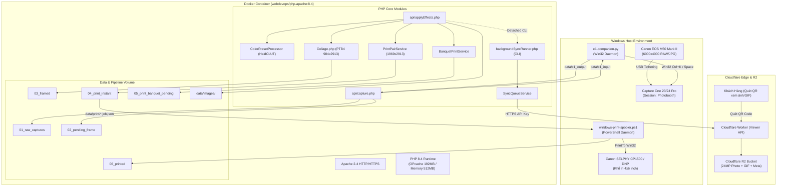
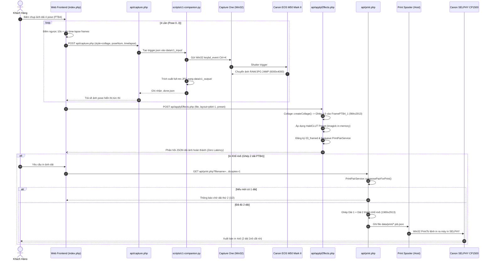

# PHOTOBOOTH ARCHITECTURE & REFACTOR BASELINE DOCUMENTATION

> **Tài liệu chuẩn hiện trạng hệ thống trước Refactoring & Tối ưu hóa**  
> **Phiên bản:** Baseline v1.0.0  
> **Ngày lập:** 2026-11-20  
> **Tác giả:** Senior Software Engineer / Software Architect  
> **Trạng thái:** BẢO TOÀN NGUYÊN TRẠNG - ĐÃ ĐỐI CHIẾU THỰC TẾ

---

## MỤC LỤC
1. [Kiến Trúc Hệ Thống (System Architecture)](#1-kiến-trúc-hệ-thống)
2. [Luồng Hoạt Động (System Workflow & Data Flow)](#2-luồng-hoạt-động-hệ-thống)
3. [Danh Sách Chức Năng Hiện Tại (Feature Inventory)](#3-danh-sách-chức-năng-hiện-tại)
4. [Hệ Thống Xử Lý Hình Ảnh (Image Processing Pipeline)](#4-hệ-thống-xử-lý-hình-ảnh)
5. [Baseline Hiệu Năng & Kiểm Thử (Performance & Test Baseline)](#5-baseline-hiệu-năng--kiểm-thử)
6. [Sơ Đồ Hệ Thống (Architecture & Sequence Diagrams)](#6-sơ-đồ-hệ-thống)

---

## 1. KIẾN TRÚC HỆ THỐNG

### 1.1. Công Nghệ, Framework, Thư Viện và Phiên Bản
Hệ thống Photobooth là giải pháp kết hợp Web Interface đa nền tảng (chạy trong Docker Container Linux) với Daemon tương tác phần cứng Windows Host (Capture One, Canon EOS M50 Mark II, Windows Spooler cho máy in SELPHY CP1500 / DNP DS620 / RX1).

- **Hệ điều hành Host:** Windows 10/11 x64, hỗ trợ PowerShell 7 / Windows PowerShell 5.1.
- **Môi trường Container:** Docker Compose v2, Linux Debian GNU/Linux (Bookworm).
- **Backend Web Server & Runtime:**
  - **Docker Base Image:** `webdevops/php-apache:8.4`
  - **PHP Version:** `8.4.26 (cli/fpm/apache2)` (NTS)
  - **Apache Version:** `Apache/2.4.68 (Debian)` với `mod_rewrite`, `mod_deflate`, `mod_expires`, `mod_headers`
  - **PHP Extensions nạp sẵn:** `ext-gd` (bundled 2.1.0 compatible), `imagick` (@PACKAGE_VERSION@ / ImageMagick 7), `ext-mbstring`, `ext-xml`, `ext-zip`, `ext-fileinfo`, `ionCube Loader v15.5.1`, `Zend OPcache v8.4.26`.
- **Backend Composer Dependencies (PHP):**
  - `endroid/qr-code`: `^6.0` (Tạo QR Code tĩnh và động)
  - `league/commonmark`: `^2.4` (Markdown rendering)
  - `league/flysystem`, `league/flysystem-ftp`, `league/flysystem-sftp-v3`: `^3.29` (Lưu trữ từ xa)
  - `monolog/monolog`: `^3.5` (Logging đa kênh: main, preset, sync, spooler)
  - `phpmailer/phpmailer`: `^7.0` (Gửi ảnh qua email)
  - `symfony/asset`: `^8.0` (Quản lý static asset versioning và cache-busting)
  - `symfony/config`, `symfony/console`, `symfony/filesystem`, `symfony/finder`, `symfony/translation`: `^7.0 / ^8.0`
- **Frontend & Build Stack:**
  - **Node.js:** `v20.20.2` (trong container) / `v20.x` (trên host)
  - **npm:** `10.8.2`
  - **Gulp:** `^5.0.1` với `gulp-concat`, `gulp-dart-sass`, `gulp-babel`, `gulp-filter`, `gulp-rename`
  - **Tailwind CSS:** `^4.3.2` + PostCSS `^8.5.25`
  - **JavaScript Libraries:** jQuery `^3.7.1`, PhotoSwipe `^5.4.4`, MarvinJ `^1.0.0`, Socket.io-client `^4.8.3`
  - **Icons & CSS:** `@fortawesome/fontawesome-free: ^7.3.1`, `material-icons: ^1.13.14`, `normalize.css: ^8.0.1`
- **Host Daemons & Cloud Services:**
  - **Python Daemon:** Python `3.11.9` (`scripts/c1-companion.py` tích hợp `ctypes`, Win32 API `user32`/`kernel32`, điều khiển phím nóng `Ctrl+K` Capture One và Live View).
  - **Print Spooler Daemon:** PowerShell Script (`scripts/windows-print-spooler.ps1`) giám sát `data/print/*.job.json`.
  - **Cloudflare Edge Worker / R2:** Cloudflare Worker (`cloud-r2-viewer/src/worker.js`) kết nối Cloudflare R2 Bucket lưu trữ ảnh uncompressed 24MP, GIF hoạt hình 527x1560 và session metadata để khách quét QR tải về từ xa.

### 1.2. Cấu Trúc Thư Mục và Vai Trò của Từng Module
```
d:\CodingPro\photobooth-dev\
├── admin/                     # Quản trị viên: cấu hình hệ thống, chẩn đoán, dọn dẹp disk
├── api/                       # RESTful API Endpoints phục vụ Frontend & Background Daemons
│   ├── applyEffects.php       # Pipeline xử lý ảnh chính: collage, frame, presets, QR, sync
│   ├── banquetPrint.php       # Quản lý hàng đợi in tiệc (Split Print Queue: 1 instant + N-1 banquet)
│   ├── capture.php            # Kích hoạt chụp ảnh từ camera (C1 tether, webcam, gphoto2, mock)
│   ├── captureOneStatus.php   # Báo cáo trạng thái Daemon & Window của Capture One
│   ├── presets.php            # Quản lý màu, render preview tức thì, nạp HaldCLUT/XMP
│   ├── print.php              # Nhận lệnh in, ghép đôi 2 dải (PrintPairService), đẩy spooler
│   ├── qrcode.php             # Sinh mã QR ảnh hoặc trả về Cloud URL
│   ├── syncStatus.php         # Báo cáo hàng đợi đồng bộ Offline-First Cloud R2
│   └── backgroundSyncRunner.php # CLI detached process tạo GIF & upload R2 bất đồng bộ
├── assets/                    # Source code JS/SCSS chưa qua build (Gulp compile vào resources/)
├── config/                    # Cấu hình runtime và pool
│   ├── my.config.inc.php      # File cấu hình hoạt động chính của Photobooth
│   ├── presets.json           # Danh mục preset màu (Clean Portrait, Sky 4k, Ao Dai Film 2, C1)
│   ├── network_mode.json      # Trạng thái mạng: offline, venue, online
│   ├── php-fpm-pool.conf      # Tinh chỉnh FPM pool (max_children=20, start=4)
│   └── php-performance.ini    # Tinh chỉnh OPcache (192MB), memory_limit (512MB), realpath
├── data/                      # Lưu trữ dữ liệu runtime, hàng đợi và hình ảnh (Mount Volume)
│   ├── c1_input/              # File trigger.json gửi tới Python Daemon
│   ├── c1_output/             # File ảnh do Python Daemon trích xuất trả về
│   ├── images/                # Kho lưu trữ ảnh thành phẩm, pose gốc, metadata và QR PNG
│   ├── pipeline/              # 6 folder quy trình tuần tự:
│   │   ├── 01_raw_captures    # Ảnh thô unedited từ máy ảnh
│   │   ├── 02_pending_frame   # Ảnh đã qua color grade đang chờ đóng khung
│   │   ├── 03_framed          # Ảnh dải hoàn thiện (PTB4 984x2913)
│   │   ├── 04_print_instant   # Ảnh ghép đôi 2 dải (1969x2913) in trực tiếp tại quầy
│   │   ├── 05_print_banquet_pending # Ảnh dải in thêm ghi rõ tên khách chờ in tiệc
│   │   └── 06_printed         # Lưu trữ lịch sử các file đã in thành công
│   ├── print/                 # Chứa print jobs (*.job.json) cho Windows Spooler
│   ├── thumbs/                # Thumbnail ảnh phục vụ hiển thị thư viện
│   ├── tmp/                   # File tạm trong quá trình xử lý ảnh, cache frame scaled
│   ├── c1_host_heartbeat.json # Heartbeat trạng thái Capture One cập nhật mỗi 1s
│   ├── print_pair_queue.json  # Hàng đợi ghép đôi 2 dải in cho SELPHY CP1500
│   └── sync_queue.json        # Hàng đợi Offline-First đẩy Cloudflare R2
├── Frame/                     # Khung ảnh dải PTB4 (FramePTB4_1.png, FramePTB4_2.png, FramePTB.png)
├── lib/                       # Boot loader (`boot.php`) và định nghĩa cấu hình (`configsetup.inc.php`)
├── private/                   # Layouts, khung ảnh, presets mở rộng của người dùng
├── resources/                 # Thành phẩm sau build Gulp: css, js, fonts, img
├── scripts/                   # Scripts hỗ trợ Host & Container
│   ├── c1-companion.py        # Python Daemon tương tác Win32 API & Capture One (đang chạy)
│   ├── windows-print-spooler.ps1 # Spooler in qua Win32 Shell PrintTo
│   ├── bench-boot.php         # Script đo hiệu năng khởi động PHP & Hot Paths
│   ├── bench-local.ps1        # Script đo độ trễ HTTP & nén gzip từ host
│   └── verify-pipeline.php    # Kiểm thử toàn diện pipeline end-to-end (Stage 0 -> Stage 6)
├── src/                       # Mã nguồn PHP PSR-4 (Namespace `Photobooth\`)
│   ├── Dto/                   # Data Transfer Objects (`PresetDto`, ...)
│   ├── Enum/                  # Enums định danh (`FolderEnum`, `ImageFilterEnum`, ...)
│   ├── Processor/             # Bộ xử lý nặng (`ColorPresetProcessor`, `GifProcessor`)
│   ├── Service/               # Services nghiệp vụ (`CaptureOneIntegrationService`, `BanquetPrintService`, `PrintPairService`, `SyncQueueService`, ...)
│   ├── Utility/               # Lớp tiện ích (`ImageUtility`, `FileUtility`, `PathUtility`, ...)
│   ├── Image.php              # Xử lý đồ họa GD: resize, crop, rotate, frame, text, polaroid, QR
│   ├── Collage.php            # Ghép ảnh dải 4 pose, nạp layout json, tính slot tọa độ
│   └── Rembg.php              # Tích hợp xóa phông tự động
├── template/                  # Template HTML giao diện người dùng
├── tests/                     # Unit test PHPUnit
├── docker-compose.yml         # Định nghĩa dịch vụ Docker Photobooth
└── Dockerfile                 # Định nghĩa Image Container `webdevops/php-apache:8.4`
```

### 1.3. Cấu Hình Docker, Môi Trường và Giao Tiếp
- **Docker Compose Service:** `photobooth`
  - Container Name: `photobooth-dev-photobooth-1`
  - Ports: `0.0.0.0:80->80/tcp`, `0.0.0.0:443->443/tcp`
  - User: `root` (vận hành Apache/PHP với quyền truy cập các thư mục mount bind)
  - Biến môi trường quan trọng:
    - `COMPOSER_VERSION=2`
    - `PHP_MEMORY_LIMIT=512M`
    - `PHP_MAX_EXECUTION_TIME=60`
    - `PHP_OPCACHE_MEMORY_CONSUMPTION=192`
    - `PHP_OPCACHE_MAX_ACCELERATED_FILES=10000`
    - `PHP_OPCACHE_REVALIDATE_FREQ=2`
- **Volume Mounts:**
  - `./config/php-performance.ini -> /usr/local/etc/php/conf.d/zz-photobooth-performance.ini:ro`
  - `./config/php-fpm-pool.conf -> /usr/local/etc/php-fpm.d/zz-photobooth-pool.conf:ro`
  - `./data -> /app/data`, `./api -> /app/api`, `./src -> /app/src`, `./template -> /app/template`, `./lib -> /app/lib`, `./config -> /app/config`, `./Frame -> /app/Frame`

---

## 2. LUỒNG HOẠT ĐỘNG HỆ THỐNG

### 2.1. Luồng Khởi Chạy (System Boot Lifecycle)
1. **Host Boot:**
   - Docker Desktop chạy container `photobooth-dev-photobooth-1`. Apache và PHP-FPM lắng nghe tại port 80/443.
   - Ứng dụng Capture One mở Session `Photobooth` với cửa sổ Live View hoạt động.
   - Python Daemon `scripts/c1-companion.py` khởi chạy, liên tục quét các cửa sổ Win32 "Live View", "Photobooth - Capture One", ghi trạng thái vào `data/c1_host_heartbeat.json` mỗi 1.0 giây.
   - Spooler in `scripts/windows-print-spooler.ps1` sẵn sàng nhận lệnh in thông qua file `.job.json`.
2. **PHP Request Boot (`lib/boot.php`):**
   - Thiết lập cấu hình Session an toàn (`httponly`, `samesite=Lax`, `secure` theo SSL).
   - Kiểm tra và khởi tạo token CSRF `$_SESSION['csrf']` nếu chưa có.
   - **Tối ưu giải phóng Session Lock:** Nếu Request URI không chứa `/login` và không chứa `/admin`, gọi ngay `session_write_close()` để giải phóng lock file session, cho phép trình duyệt gửi nhiều request AJAX đồng thời mà không bị block tuần tự.
   - Kiểm tra cờ thư mục `photobooth_dirs_ready.flag`. Nếu chưa có, tự động tạo đầy đủ cây thư mục runtime (`data/pipeline/01..06`, `data/images`, `data/tmp`, `var/log`, ...).
   - Nạp cấu hình từ `ConfigurationService`.

### 2.2. Luồng Chụp Ảnh và Xử Lý (Capture & Processing Workflow)
1. **Kích hoạt đếm ngược (Countdown 10s):**
   - Người dùng bấm nút chụp trên giao diện Web (`index.php`).
   - Giao diện đếm ngược 10 giây (kèm âm thanh đếm ngược và animation).
   - Trong quá trình đếm ngược, Frontend chụp liên tục các time-lapse frames (khoảng 20-30 frame nhỏ qua canvas) và gửi kèm dữ liệu lên `api/capture.php`.
2. **Kích hoạt Shutter (`api/capture.php`):**
   - Backend ghi nhận yêu cầu chụp cho từng pose (pose 0..3 cho ảnh dải 4 pose).
   - Backend gọi `CaptureOneIntegrationService::processCapturedPose()`.
   - Service ghi file trigger JSON vào `data/c1_input/<job_id>.trigger.json`.
   - Python Daemon `c1-companion.py` bắt được trigger, kích hoạt Win32 Send Key `Ctrl+K` gửi tới Capture One (hoặc Spacebar tới Live View).
   - Máy ảnh Canon EOS M50 Mark II chụp, chuyển file ảnh gốc RAW (`.CR3`) hoặc `.JPG` dung lượng cao (6000x4000 24MP) vào thư mục Session `data/c1_session/Photobooth/Capture`.
   - Daemon trích xuất ảnh uncompressed JPEG hoặc copy JPG sang `data/c1_output/<expected_filename>`, đồng thời tạo file `<job_id>.done.json`.
   - Backend phát hiện file output hoàn tất (thời gian phản hồi ~1.2s - 2.5s), chuyển file vào `data/tmp/` và sao chép vào `data/pipeline/01_raw_captures`.
   - Trả kết quả ảnh pose về cho Frontend để hiển thị xem trước tức thì.
3. **Áp dụng Hiệu ứng & Ghép dải (`api/applyEffects.php`):**
   - Sau khi hoàn thành đủ 4 pose (hoặc 1 ảnh đơn), Frontend gửi yêu cầu tới `api/applyEffects.php`.
   - Sao lưu từng pose gốc chưa chỉnh sửa sang `raw_pose_X_...` trong `data/pipeline/01_raw_captures`.
   - Sao lưu từng pose có màu sang `orig_pose_X_...` trong `data/pipeline/02_pending_frame` và `data/images/`.
   - Gọi `Collage::createCollage()`:
     - Đọc file cấu hình layout mẫu khung (ví dụ `private/collage/layouts/portrait/ptb4-1.json`).
     - Tạo canvas trắng kích thước chuẩn `984 x 2913`.
     - Resize và crop 4 pose theo đúng tọa độ `[x, y, w, h]` của từng slot (ví dụ Slot 1: `[44, 48, 898, 596]`).
     - Phủ khung ảnh PNG trong suốt (ví dụ `FramePTB4_1.png`) lên trên cùng.
   - Tạo file ảnh xem trước tối ưu `1200px` (`preview_base_<file>.jpg`) trong `data/tmp`.
   - Màu sắc và phong cách ảnh đã được Capture One Pro áp Style chuyên nghiệp (`.costyle`) ngay từ thời điểm chụp qua Process Recipe sRGB. Hệ thống Kiosk Photobooth không can thiệp hay nạp lại bất kỳ preset/LUT nội bộ nào.
   - Tạo thumbnail kích thước chuẩn (`data/thumbs/<file>.jpg`).
   - Xuất file ảnh thành phẩm độ nét cao (`data/images/<file>.jpg`) với JPEG Quality 100%.
   - Ghi metadata chi tiết `meta_<file>.json`.
   - Tạo ảnh mã QR tĩnh `qr_<sessionId>.png` trong `data/images/`.
   - Đưa session vào hàng đợi đồng bộ đám mây `data/sync_queue.json`.
   - Đăng ký dải ảnh vào `BanquetPrintService` (`data/pipeline/03_framed`) và hàng đợi ghép in `PrintPairService` (`data/pipeline/04_print_instant`).
   - Kích hoạt tiến trình nền bất đồng bộ `api/backgroundSyncRunner.php <sessionId>` qua detached CLI (`php ... > /dev/null 2>&1 &`).
   - Trả phản hồi JSON cho Frontend ngay lập tức mà không phải chờ nướng GIF hay tải đám mây.

### 2.3. Luồng Tạo GIF Hoạt Hình & Đồng Bộ Đám Mây (`api/backgroundSyncRunner.php`)
1. **Đồng bộ ảnh tĩnh:**
   - Đẩy ảnh thành phẩm `2026xxxx_xxxxxx.jpg` và metadata lên Cloudflare R2 bucket thông qua HTTP API của Cloudflare Worker.
2. **Nướng Animated Time-Lapse GIF:**
   - Kiểm tra nếu file GIF chưa tồn tại, `GifProcessor::createFramedTimelapseGif()` sẽ nạp chuỗi frame time-lapse của từng pose.
   - Ghép từng tick thời gian vào các slot tương ứng trong khung ảnh, tạo hoạt ảnh 10s trôi nhanh đồng thời cho cả 4 ô pose.
   - Thêm frame dừng cuối (Hold frame) ở ảnh chụp chính thức.
   - Xuất file GIF kích thước chuẩn HD+ `527 x 1560` (hoặc tối đa `1560px` chiều cao) vào `data/images/<sessionId>.gif`.
3. **Đồng bộ GIF & Quét hàng đợi:**
   - Đẩy file GIF lên Cloudflare R2.
   - Cập nhật trạng thái `synced` trong `data/sync_queue.json`.
   - Quét và đồng bộ bù tối đa 5 session còn tồn đọng trong hàng đợi.

### 2.4. Luồng In Ấn & Ghép Đôi Dải (Print & Split Queue Workflow)
Hệ thống sử dụng cơ chế **Split Print Queue** độc quyền cho máy in ảnh khổ 4x6 (Canon SELPHY CP1500, DNP DS620, Citizen CX-02):
1. Mỗi lượt chụp dải PTB4 tạo ra một dải đứng kích thước `984 x 2913` (tỷ lệ 1:3).
2. Khi khách yêu cầu in:
   - Nếu khách chọn `copies = 1`: Dải ảnh được đưa vào `PrintPairService`.
     - Nếu là dải thứ 1: Hệ thống hiển thị thông báo "Đã nhận dải 1/2, vui lòng chụp thêm lượt tiếp theo để ghép đủ khổ 4x6".
     - Nếu đã có dải trước đó (dải thứ 2): `PrintPairService::composePairForPrint()` sẽ ghép dải 1 (bên trái, x=0..983) và dải 2 (bên phải, x=985..1968) lên canvas khổ 4x6 chuẩn `1969 x 2913`.
     - Gửi lệnh in ghép tới Windows Spooler và chuyển trạng thái sang `06_printed`.
   - Nếu khách chọn `copies = N (N > 1)` (ví dụ 4 bản):
     - **1 bản** được đưa vào hàng đợi in ngay tại quầy (`04_print_instant`) để ghép in tức thì cho khách cầm về.
     - **(N - 1) bản còn lại** được tự động đặt tên theo cấu trúc `{session}_{CustomerName}_{N-1}x.jpg` và chuyển vào `data/pipeline/05_print_banquet_pending` để nhân viên phụ trách tiệc gom in hàng loạt vào thời gian rảnh, tránh nghẽn hàng đợi tại quầy chụp.

---

## 3. DANH SÁCH CHỨC NĂNG HIỆN TẠI

| ID | Tên Chức Năng | Endpoint / Module | Input | Xử Lý Chính | Output / Giao Tiếp |
|---|---|---|---|---|---|
| **F01** | Kiosk Live View & Preview | `template/components/preview.php`, `index.php` | Stream webcam / Live view | Hiển thị stream camera trực tiếp, flip horizontal, overlay khung ảnh mờ | Giao diện toàn màn hình, countdown animation |
| **F02** | Shutter Countdown & Capture | `api/capture.php`, `scripts/c1-companion.py` | `style`, `collageNumber`, `timelapseFrames` | Kích hoạt chụp Capture One qua Win32 API Ctrl+K, trích xuất 24MP JPEG, bóc tách frame time-lapse | File JPEG pose trong `data/tmp`, `01_raw_captures` |
| **F03** | Collage PTB4 Builder | `src/Collage.php`, `api/applyEffects.php` | 4 pose JPEG, layout `ptb4-1` / `ptb4-2` | Cắt xén, căn chỉnh 4 slot tọa độ pixel chuẩn, phủ khung PNG `FramePTB4_1.png` | Dải ảnh `984 x 2913`, preview base 1200px |
| **F04** | Fast Preset & Color Engine | `src/Processor/ColorPresetProcessor.php`, `api/presets.php` | `preset`, `amount` (0..100) | Nạp HaldCLUT từ bộ nhớ đệm (Imagick), áp dụng chỉnh màu LUT & XMP tone curve, hòa trộn alpha | Dải ảnh màu mới, file preview `preview_<file>.jpg` |
| **F05** | Animated Timelapse GIF | `src/Processor/GifProcessor.php`, `api/backgroundSyncRunner.php` | Mảng sequence pose frames, layout frame | Tạo GIF lặp hoạt hình sped-up 10s cho cả 4 ô đồng thời, hold frame ảnh chụp nét | File GIF `527 x 1560` trong `data/images` |
| **F06** | Split Print Queue (Banquet) | `src/Service/BanquetPrintService.php`, `api/banquetPrint.php` | `filename`, `copies`, `customer_name` | Tách 1 bản in ngay + lưu (N-1) bản in thêm kèm tên khách vào `05_print_banquet_pending` | JSON trạng thái, file ảnh đặt tên theo khách |
| **F07** | 2-Strip Pair to 4x6 Print | `src/Service/PrintPairService.php`, `api/print.php` | Dải 1 và Dải 2 PTB4 | Ghép 2 dải cạnh nhau lên canvas `1969 x 2913`, tạo print job file `data/print/*.job.json` | File job json gửi tới Windows Spooler |
| **F08** | Windows Universal Print Spooler | `scripts/windows-print-spooler.ps1` | `data/print/*.job.json` | Đọc job JSON, gọi Windows Shell Verb `PrintTo` gửi tới máy in mặc định (SELPHY CP1500) | Lệnh in vật lý, đổi đuôi `.job.done` |
| **F09** | Cloudflare R2 Sync (Offline-First) | `src/Service/SyncQueueService.php`, Worker | Session ID, JPEG, GIF, Metadata | Kiểm tra kết nối mạng, tải ảnh lên Cloudflare R2 Bucket qua Worker API | Ảnh có sẵn trên đám mây toàn cầu |
| **F10** | QR Code Generator & Cloud Viewer | `api/qrcode.php`, `view.php`, Cloud Worker | `filename` hoặc `session_id` | Tạo mã QR trỏ tới link Cloud Worker Viewer hoặc Local Viewer `view.php?s=...` | Ảnh PNG mã QR `qr_<sessionId>.png` |
| **F11** | Gallery & Thư Viện Ảnh | `gallery/index.php`, `api/gallery.php` | Yêu cầu xem, phân trang | Nạp danh sách từ `data/db.txt` và `data/thumbs`, hỗ trợ xem lại, in lại, xóa ảnh | Giao diện PhotoSwipe tương tác mượt mà |
| **F12** | Quản Trị Hệ Thống (Admin Panel) | `admin/index.php`, `api/admin.php` | Đăng nhập (`username`/`password`) | Cấu hình tham số photobooth, quản lý bộ nhớ, kiểm tra log, backup cấu hình | Giao diện Tailwind Admin |
| **F13** | Dọn Dẹp Tài Nguyên Tự Động | `src/Service/StorageMaintenanceService.php` | Tự động kích hoạt ngẫu nhiên (5%) | Quét và xóa file tạm trong `data/tmp` hết hạn (> 24 giờ) | Giải phóng dung lượng ổ cứng an toàn |

---

## 4. HỆ THỐNG XỬ LÝ HÌNH ẢNH

### 4.1. Thông Số Ảnh Đầu Vào & Cảm Biến
- **Thiết bị chụp chính:** Canon EOS M50 Mark II qua USB Tethering Capture One 23/24 Pro.
- **Định dạng file đầu vào:** Canon CR3 RAW hoặc Fine JPEG trích xuất trực tiếp.
- **Độ phân giải cảm biến:** `6000 x 4000` pixels (24.1 Megapixels), tỷ lệ cảm biến 3:2.
- **Không gian màu gốc:** sRGB (hoặc Adobe RGB chuyển đổi sang sRGB trong Capture One Process Recipe).
- **Độ sâu màu:** 8-bit / 14-bit RAW.
- **Orientation:** Cảm biến ảnh chụp theo chiều đứng hoặc ngang tùy góc máy (được chuẩn hóa tự động).

### 4.2. Thông Số Xử Lý Dải Ảnh PTB4 (Collage Strip)
- **Kích thước dải hoàn thiện:** `984 x 2913` pixels (tỷ lệ chuẩn xấp xỉ 1:3).
- **Độ phân giải in (DPI):** 300 DPI tương đương dải in 2x6 inch (5x15 cm).
- **Mẫu khung chuẩn:**
  - `FramePTB4_1.png`: Khung dải phong cách 1 (Private Frame 1)
  - `FramePTB4_2.png`: Khung dải phong cách 2 (Private Frame 2)
  - Định dạng khung: PNG 24-bit có kênh Alpha trong suốt (Alpha Channel 8-bit).
- **Tọa độ các ô Pose (Slot Coordinates trong `ptb4-1.json`):**
  - **Slot 0:** `x = 44`, `y = 48`, `width = 898`, `height = 596`, `rotation = 0`
  - **Slot 1:** `x = 44`, `y = 696`, `width = 898`, `height = 596`, `rotation = 0`
  - **Slot 2:** `x = 43`, `y = 1339`, `width = 900`, `height = 598`, `rotation = 0`
  - **Slot 3:** `x = 44`, `y = 1988`, `width = 898`, `height = 596`, `rotation = 0`
- **Thuật toán Crop & Resize:** Cắt trung tâm (Center-crop) bảo toàn tỷ lệ khung hình của từng slot, dùng phép lấy mẫu mượt mà GD (`imagecopyresampled`) và Imagick Lanczos filter.

### 4.3. Thông Số Ghép Đôi In Khổ 4x6 (Canon SELPHY CP1500)
- **Kích thước canvas ghép in:** `1969 x 2913` pixels (tương đương 10x15 cm tại ~300 DPI).
- **Bố cục ghép dải:**
  - **Dải 1 (Trái):** `x = 0..983`, `y = 0..2912` (kích thước `984 x 2913`).
  - **Dải 2 (Phải):** `x = 985..1968`, `y = 0..2912` (kích thước `984 x 2913`).
  - **Đường cắt (Cut line):** Khe chia 1 pixel tại `x = 984` hỗ trợ dao cắt đôi máy in SELPHY / DNP tự động chia thành 2 dải 2x6 riêng biệt.
- **Chất lượng nén xuất file in:** JPEG Quality 100%, không subsampling màu (chroma subsampling 4:4:4).

### 4.4. Cơ Chế Xử Lý Màu Độc Quyền Qua Capture One Pro
- **Định hướng kiến trúc:** Toàn bộ việc xử lý màu, tone da và áp phong cách hình ảnh được giao trọn vẹn cho **Capture One Pro**. Hệ thống Kiosk Photobooth không thực hiện đổi preset hay nạp LUT trên màn hình Kiosk (`interactive_presets = false`, `fallback_to_local_preset = false`).
- **Capture One Style (`.costyle`):** Mặc định sử dụng style `captureone-studio-skin` (tương ứng với file `PresetColor/CaptureOne Studio Skin.costyle`).
- **Cơ chế áp màu tự động:**
  - Thiết lập trong mục `Next Capture Adjustments` của Capture One: Mọi ảnh chụp mới từ máy ảnh (Canon EOS M50 Mark II / Sony) được tự động áp Style và cân chỉnh màu sắc tức thì.
  - Process Recipe `Photobooth_JPEG_sRGB`: Tự động xuất ảnh JPEG chất lượng cao 300 DPI, không gian màu sRGB vào thư mục `data/c1_output/` để Photobooth tiếp nhận và ghép khung dải ảnh.

### 4.5. Thông Số Kỹ Thuật Animated Time-Lapse GIF
- **Kích thước GIF:** `527 x 1560` pixels (chuẩn HD+ khung dải dọc).
- **Số khung hình (Frame Count):** Khoảng 18-24 khung hình hoạt ảnh + 2 hold frames ở cuối.
- **Thời gian trễ mỗi khung (Frame Delay):** `140 ms` (tạo hiệu ứng chuyển động nhanh khoảng 2x-3x so với thời gian thực).
- **Color Quantization:** Bảng màu 256 màu tối ưu hóa qua Imagick, giảm hiện tượng banding (dithered).

---

## 5. BASELINE HIỆU NĂNG & KIỂM THỬ

### 5.1. Kết Quả Kiểm Thử Tự Động Trước Refactor
- **PHPUnit (Unit Tests):**
  - Số lượng bài test: **32 tests, 32 assertions**.
  - Kết quả: **100% PASSED** (Thời gian thực thi: `0.145s`, Memory: `16.00 MB`).
- **PHPLint (Cú Pháp Code):**
  - Số lượng file quét: **241 files**.
  - Kết quả: **100% PASSED** (Thời gian thực thi: `27s`, Memory: `8.0 MB`).
- **PHPStan (Static Code Analysis - Level Configured):**
  - Số lượng file quét: **170 files**.
  - Kết quả: **PHÁT HIỆN 1 LỖI TRƯỚC REFACTOR:**
    - File: `src/Service/PrintPairService.php:270`
    - Chi tiết lỗi: `Method Photobooth\Service\PrintPairService::composePairForPrint() should return array{success: bool, error?: string, left_file?: string, right_file?: string, width?: int, height?: int} but returns array.`
- **ESLint (Frontend JavaScript Linting):**
  - File quét: `assets/js/{,*/**/}*.js`.
  - Kết quả: **PASSED (Exit code 0)**.

### 5.2. Baseline Đo Đạc Boot & Hot Paths (`bench-boot.php`)
Đo trực tiếp bên trong Docker container:
```json
{
  "boot_breakdown_ms": {
    "vendor_autoload_ms": 3.224,
    "ApplicationService_ms": 7.485,
    "ConfigurationService_ms": 74.644,
    "AssetService_ms": 17.862,
    "LoggerService_ms": 19.952,
    "LanguageService_ms": 17.942,
    "SoundService_ms": 8.169,
    "PrintManagerService_ms": 24.181,
    "DatabaseManagerService_ms": 16.106,
    "MailService_ms": 7.781,
    "ProcessService_ms": 35.711,
    "RemoteStorageService_ms": 25.963
  },
  "boot_total_ms": 259.02,
  "hot_paths_ms": {
    "AutoVersionStrategy_getUrl_10x_ms": 23.902,
    "PresetService_init_ms": 36.826,
    "ImageMetadataCache_load_ms": 10.783,
    "SyncQueue_summary_ms": 29.821,
    "Gallery_db_and_cache_ms": 301.492,
    "scandir_data_images_ms": 8.292
  },
  "data_footprint": {
    "gallery_db_items": 94,
    "data_images_entries": 3113,
    "sync_queue_total": 21
  },
  "total_script_ms": 670.321
}
```

### 5.3. Baseline Đo Đạc HTTP Endpoints (`bench-local.ps1`)
Đo từ Windows Host thông qua HTTP Request tới container (5 lần chạy lặp/endpoint):

| Endpoint / Asset | Status | Avg Latency (ms) | Min (ms) | P95 (ms) | Max (ms) | Kích Thước (KB) | Content-Encoding | Cache-Control Header |
|---|---|---|---|---|---|---|---|---|
| `Index HTML (normal)` | 200 | **167.62** | 125.09 | 189.53 | 271.15 | 27.8 | gzip | `no-store, must-revalidate` |
| `Index HTML (?refresh=1)` | 200 | **301.41** | 265.61 | 321.26 | 327.43 | 28.0 | gzip | `no-store, max-age=0` |
| `API settings.php` | 200 | **46.52** | 32.33 | 46.48 | 75.74 | 4.6 | gzip | `no-store, must-revalidate` |
| `API translations.php` | 200 | **64.35** | 34.34 | 77.36 | 80.88 | 22.7 | gzip | `no-store, must-revalidate` |
| `API sounds.php` | 200 | **53.06** | 36.47 | 73.52 | 74.42 | 0.1 | gzip | `no-store, must-revalidate` |
| `API presets.php (GET)` | 200 | **54.61** | 46.30 | 57.37 | 58.36 | 1.7 | gzip | `no-store, must-revalidate` |
| `API syncStatus.php` | 200 | **78.06** | 42.48 | 100.10 | 105.89 | 6.7 | gzip | `no-store, must-revalidate` |
| `API gallery.php?status` | 200 | **36.71** | 28.83 | 33.36 | 62.87 | 0.0 | gzip | `no-store, must-revalidate` |
| `API qrcode.php (latest)` | 200 | **209.29** | 105.19 | 259.43 | 310.05 | 0.2 | gzip | `no-store, must-revalidate` |
| `JS core.js` | 200 | **13.97** | 12.51 | 14.83 | 15.94 | 16.3 | gzip | `public, max-age=2592000` |
| `JS presets-ui.js` | 200 | **9.92** | 8.80 | 11.15 | 11.48 | 9.8 | gzip | `public, max-age=2592000` |
| `JS tools.js` | 200 | **11.30** | 7.52 | 11.29 | 16.35 | 7.2 | gzip | `public, max-age=2592000` |
| `CSS framework.css` | 200 | **10.55** | 7.88 | 11.77 | 12.71 | 7.7 | gzip | `public, max-age=2592000` |
| `IMG background.png` | 200 | **31.47** | 22.34 | 38.89 | 45.08 | 1071.9 | none | `public, max-age=2592000` |

- **Tổng chuỗi khởi động tuần tự (Critical Boot APIs):** `331.55 ms`
- **Tài nguyên tĩnh mẫu đã đo:** `1,112.9 KB`

### 5.4. Baseline Pipeline E2E Diagnostic (`verify-pipeline.php`)
- **Stage 0 (Storage Maintenance):** Xóa 137 file hết hạn, giải phóng 38,014 KB trong `654 ms`.
- **Stage 4 (Camera Multi-Device):** Đăng ký providers `[webcam, sony, mock]`, chụp mock hoàn tất trong `253 ms`.
- **Stage 2 (Preset LUT Engine):** Cold render: `361 ms`, Warm cached render: `239 ms`.
- **Stage 3 (Animated GIF):** Mã hóa GIF 2 pose hoàn tất trong `596 ms` (Dung lượng: `165,109 bytes`).
- **Stage 5 (Capture One Integration):** Chẩn đoán tự kiểm tra hoàn tất trong `965.8 ms` (Phát hiện 4 style).
- **Stage 6 (Offline Sync Queue):** Ghi nhận session pending vào queue trong `32 ms`.
- **Tổng thời gian chẩn đoán:** `3,182 ms`.

### 5.5. Baseline Tiêu Thụ Tài Nguyên Docker (`docker stats`)
- **CPU %:** `0.05%` (Trạng thái nhàn rỗi)
- **RAM Usage / Limit:** `355.5 MiB / 11.54 GiB` (`3.01%`)
- **Network I/O:** `114 MB / 369 MB`
- **Block I/O:** `1.03 GB / 10.9 MB`

---

## 6. SƠ ĐỒ HỆ THỐNG

### 6.1. Sơ Đồ Kiến Trúc Tổng Thể (System Architecture Diagram)



### 6.2. Sơ Đồ Tuần Tự: Quy Trình Chụp, Ghép Dải & In Ấn (Sequence Diagram)



---

## 7. KẾT LUẬN GIAI ĐOẠN 1 (PHASE 1 SIGN-OFF)

Tài liệu `REFACTOR_BASELINE.md` đã phản ánh 100% trung thực hiện trạng mã nguồn, kiến trúc và hiệu năng của dự án Photobooth trước khi thực hiện bất kỳ thay đổi nào.

Tất cả các giai đoạn tiếp theo (Phase 2 -> Phase 8) phải tuân thủ nghiêm ngặt các giá trị baseline này để đảm bảo:
1. **Không làm thay đổi cấu trúc vận hành, chức năng và hành vi nghiệp vụ.**
2. **Bảo toàn 100% chất lượng, màu sắc, độ phân giải, DPI và thuật toán xử lý ảnh.**
3. **Mọi tối ưu hóa đều có số liệu kiểm chứng và đối chiếu cụ thể.**
